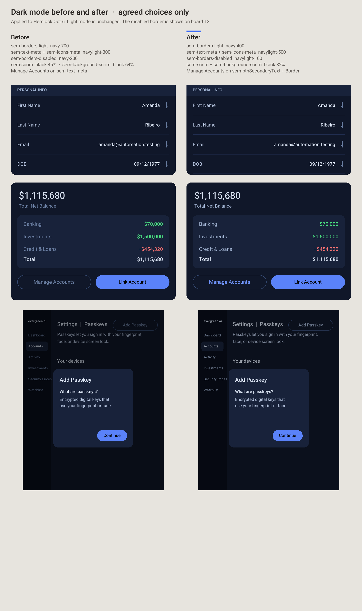
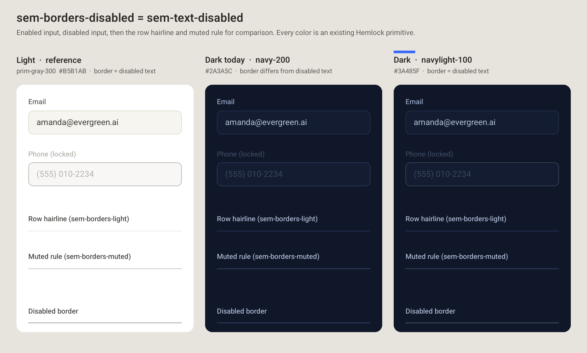

# Dark-mode token retune — Oct 6, 2026

This folder documents **only** the six dark-mode token changes made to `hemlock-library.lib.pen` on Oct 6, 2026. Light mode is unchanged. No tokens were added, removed, or renamed.

The full canonical set (all 382 tokens, both themes) is still `../dark-mode-handoff/` — it already includes these six changes (design-specs commit `ed4bf97`). Use this folder to see what changed; use the canonical folder as the source for the complete values.

Files:

- **dark-retune.css** — the six new dark declarations, scoped to `html[data-theme="dark"]`.
- **dark-retune.tokens.json** — the six tokens with their light value (unchanged), old dark value, and new dark value.
- **10-before-after.png** — dark mode before and after: row borders, meta text, the Manage Accounts button, and the dialog scrim.
- **12-disabled-border-matches-text.png** — the disabled input border now matches the disabled label and value.

## What changed (dark only)

| Token | Dark (new) | Dark (was) | Why |
|---|---|---|---|
| `sem-borders-light` | `#202C4E` navy-400 | `#131C31` navy-700 | Row and table hairlines were invisible on `sem-background-main` and identical to `sem-background-surface` |
| `sem-text-meta` | `#9DAFCD` navylight-500 | `#697DA0` navylight-300 | Quiet labels (Total Net Balance, Banking, Investments, chart axes) read as disabled |
| `sem-icons-meta` | `#9DAFCD` navylight-500 | `#697DA0` navylight-300 | Stays matched with `sem-text-meta` |
| `sem-borders-disabled` | `#3A485F` navylight-100 | `#2A3A5C` navy-200 | Matches `sem-text-disabled`, so a disabled field's border, label, and value are one color (light already does this with gray-300) |
| `sem-scrim` | `#00000052` black 32% | `#00000073` black 45% | The page behind dialogs went nearly black |
| `sem-background-scrim` | `#00000052` black 32% | `#000000A3` black 64% | Same film as `sem-scrim` in dark |

## Rules that come with this change

- **Secondary and outline buttons** (for example, Manage Accounts) bind text to `sem-btnSecondaryText` and the stroke to `sem-btnSecondaryBorder` in both themes — never `sem-text-meta` or a primitive. Those two tokens did not change (dark: blue-400 `#7094FB` text, navy-50 `#33476E` border).
- **Disabled is one color in dark**: `sem-borders-disabled` = `sem-text-disabled` = navylight-100 `#3A485F`.
- **Both scrims are black 32% in dark.** In light they still differ (`sem-scrim` `#00000055`, `sem-background-scrim` `#2D292657`) — unchanged.

## Left alone on purpose

- `sem-borders-muted` (dark navy-200) and `sem-chatDivider` (dark navy-700) — not changed.
- `sem-borders-dark` (enabled input border, dark navy-300) — not changed.
- `sem-btnSecondaryText` / `sem-btnSecondaryBorder` — not changed; only the binding rule above.

## Deferred (not part of this change)

- **Pencil edit icons** in Settings are clickable, so they should eventually use the action icon color (`sem-icons-action`) instead of `sem-icons-meta`. Deprioritized — do not change them with this ticket.
