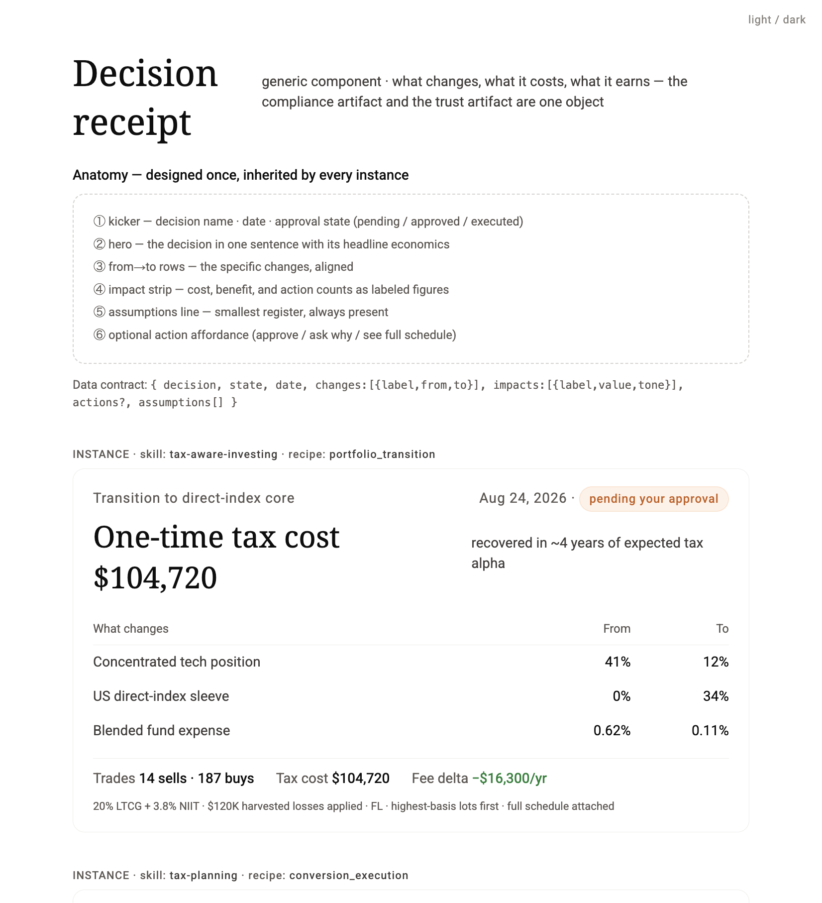
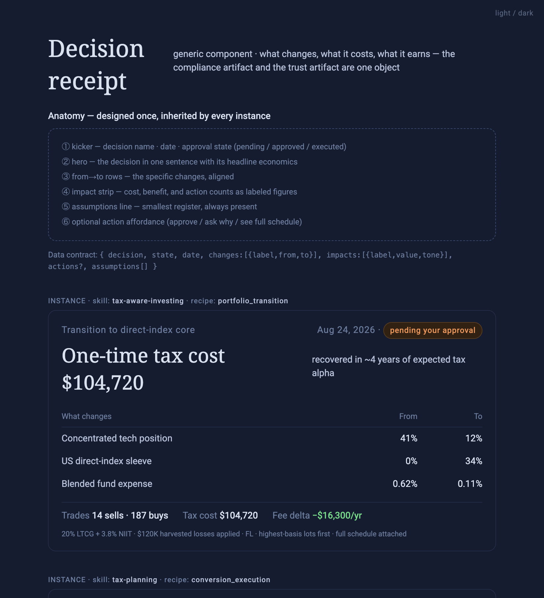
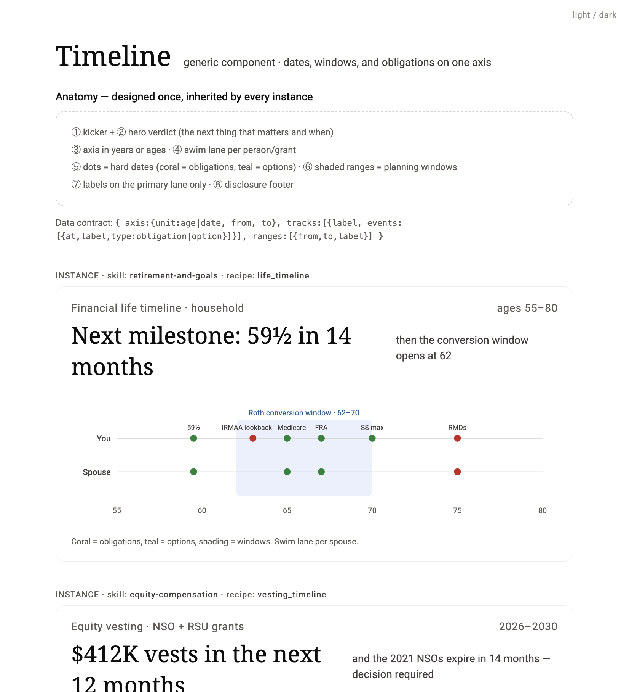
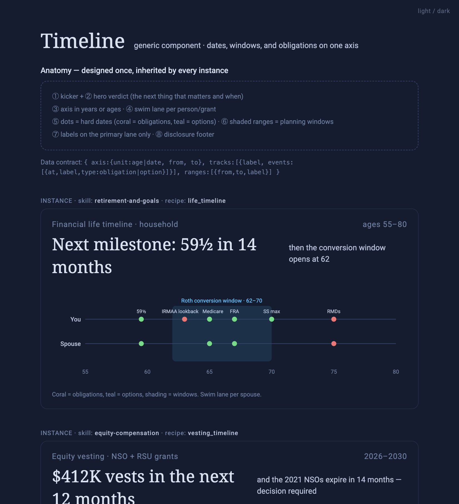
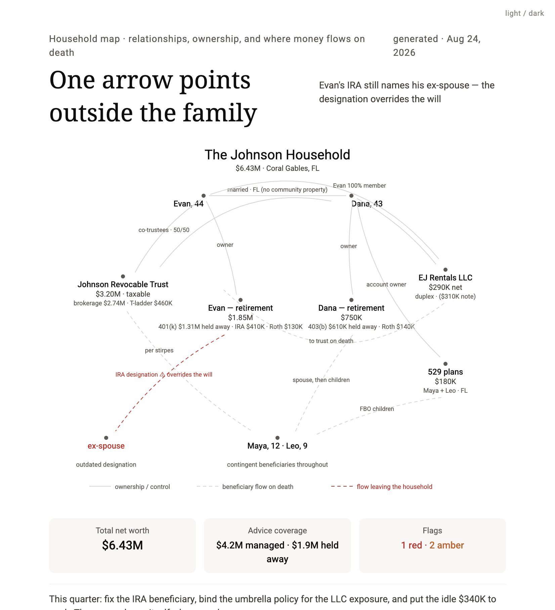
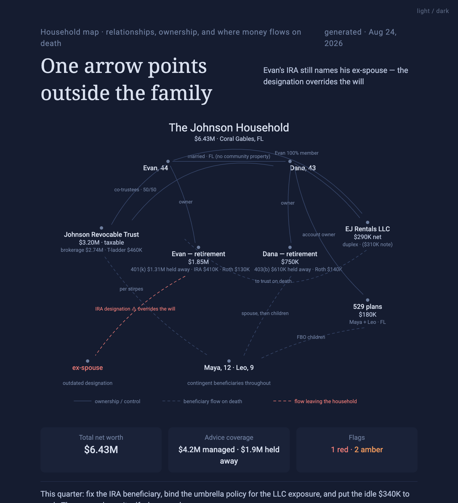
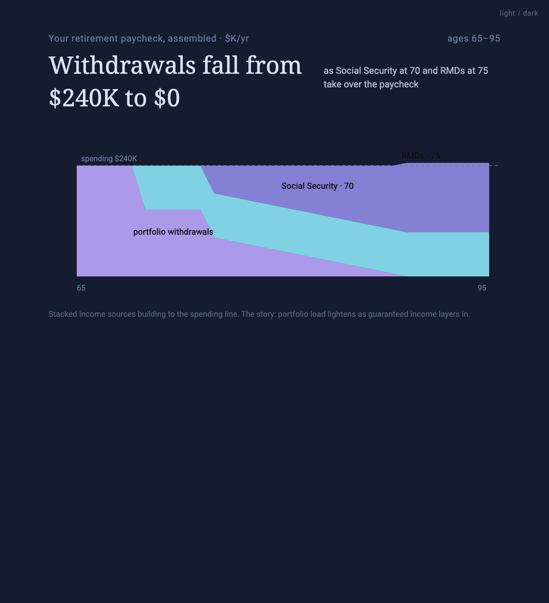

# Evergreen Component Handoffs — Hemlock Token Alignment

> **Date:** 2026-08-26
> **Source of truth:** `pencil/design-system/in-progress/hemlock-library.lib.pen`
> **Files:** 14 self-contained HTML handoffs (index + 13 components) in the `HTMLs/` subfolder
> **Origin:** `evergreen-component-handoffs-hemlock.zip` (previously aligned to Component Template v2.0 on 2026-08-25)

---

## Summary

The 14 handoff files were re-aligned from the Component Template v2.0 token set to the
current `hemlock-library.lib.pen` tokens. Four deliberate deviations were resolved in favor
of the library: dark mode moved to the Hemlock navy theme, light-mode info moved to the sky
palette, light status tiles moved from alpha washes to opaque semantic values, and off-scale
type/radii were snapped to the Hemlock scales. A separate text-overlap sweep fixed four
label collisions across two files.

## Already aligned — no changes needed

- Fonts: Heebo (primary) + Noto Serif (secondary)
- Full categorical chart palette (`--cat1`–`--cat8`), both modes
- Full sequential chart palette (`--seq1`–`--seq7`), both modes
- Accent/action blues (`--accent`, `--accent-hover`)
- Positive/negative/warning status colors, both modes
- All dark status surfaces (pros/cons/info/warn backgrounds + borders)
- Light text roles (`--ink`, `--text-body`, `--muted`, `--faint`), light borders, light surfaces
- Most radii (4px / 8px / 12px / 999px)

## Changes applied

### 1. Dark mode → Hemlock navy theme

| Token | Was (neutral register) | Now (Hemlock navy dark) |
|---|---|---|
| `--surface-1` / `--page-bg` | `#232322` / `#1A1A19` | `#131C31` (navy-700) |
| `--surface-2` / `--nest` | `#232322` | `#18223A` (navy-600) |
| `--border` / `--border-strong` | `rgba(255,255,255,.12/.28)` | `#2A3A5C` / `#33476E` |
| `--ink` / `--text-header` | `#F0EFEC` | `#D8E1F0` (navylight-800) |
| `--text-body` | `#C3C2B7` | `#B3C1DB` (navylight-600) |
| `--muted` / `--faint` | `#898781` | `#697DA0` / `#52637F` |
| `--accent-subtle` | `rgba(90,130,249,0.16)` | `#16304A` (skydark-100, opaque) |

Dark accents, status, and chart tokens already matched the library and are unchanged.

### 2. Light-mode info → sky palette

| Token | Was | Now |
|---|---|---|
| `--info` / `--info-title` | `#3A6AF8` (blue-600) | `#1F6193` (`sem-text-info-title`, sky-600) |
| `--info-bg` | `rgba(58,106,248,.06)` | `#EBF6FF` (`sem-background-info`, sky-50) |
| `--info-border` | `rgba(58,106,248,.24)` | `#AEDCFE` (`sem-borders-info`, sky-100) |

Dark info was already sky (`#38BDF8`); light now matches dark and the library.

### 3. Light status tiles → opaque semantic values

| Token | Was (alpha wash) | Now (opaque) |
|---|---|---|
| `--pros-bg` / `--pros-border` | `rgba(20,131,56,.07/.25)` | `#E9FFF0` / `#A9FDC4` |
| `--cons-bg` / `--cons-border` | `rgba(200,35,32,.06/.22)` | `#FFEAEA` / `#FED5D4` |
| `--warn-border` | `#FDC9A6` (orange-200) | `#FEE4D2` (`sem-borders-warning`, orange-100) |

### 4. Typography snapped to the Hemlock scale

| Was | Now | Occurrences |
|---|---|---|
| 13px | 14px | 61 |
| 19px | 20px | 6 |
| 28px | 30px | 29 |
| 34px | 36px | 14 (serif heroes) |

Hemlock scale: 11 / 12 / 14 / 16 / 18 / 20 / 24 / 30 / 36.

### 5. Radius snap

`border-radius: 6px` → `8px` (`radius-2xs`) per `hemlock-html-handoff.md` §6 — 13 occurrences
in `HTMLs/13-style-box.html` and `HTMLs/generic-headroom-meter.html`.

### 6. Documentation in file headers

Each file's comment block now reads `HEMLOCK ALIGNMENT (2026-08-26) — palette aligned to
hemlock-library.lib.pen tokens`, and the navy dark block is documented in place of the old
"neutral dark register" note.

## Text-overlap sweep

All 14 files were scanned with a geometry check (rendered SVG text bounding boxes with
fonts loaded, per-SVG, both themes share geometry). Four collisions found and fixed with
minimal label nudges — no content, layout, or design changes:

| File | Collision | Fix |
|---|---|---|
| `HTMLs/19-household-map.html` | `401(k) $1.31M held away…` vs `403(b) $610K held away…` (Evan/Dana retirement sub-labels, 22px overlap) | Evan's label x 285→270, Dana's x 450→465 |
| `HTMLs/19-household-map.html` | `per stirpes` vs `IRA designation ⚠ overrides the will` (full overlap) | `per stirpes` moved up-left along its own curve: (200,350)→(164,313) |
| `HTMLs/19-household-map.html` | `married · FL (no community property)` vs `Evan 100% member` (28px overlap) | `Evan 100% member` x 426→462 |
| `HTMLs/generic-timeline.html` | `IRMAA lookback` vs `Medicare` (7px overlap) | `IRMAA lookback` x 239→231, `Medicare` x 284→290 |

The other 12 files are clean. Tight stacked node labels (title/value/detail lines) measure
as font line-box grazes only — no visible ink collision — and were intentionally left alone.

## SVG paint order: edges always under text

In `HTMLs/19-household-map.html`, edge curves were interleaved with text in document order, so
later edges painted **over** earlier labels (visible as lines crossing through
`IRA designation ⚠ overrides the will`, `per stirpes`, `to trust on death`, and others).
SVG paint order is document order, so the SVG children were reordered into layers:

1. `<title>` (accessibility)
2. edges — `<path>` / `<line>` (original relative order preserved)
3. fills — `<rect>` / `<polygon>` (none in this file)
4. node dots — `<circle>`
5. all `<text>` labels (always on top)

Geometry is unchanged — this is purely a paint-order fix. The same audit (does any
`path`/`line` follow and intersect a `text` box?) was run on all 14 files; household-map
was the only file affected. Note the deliberate exception this rule preserves: in
`HTMLs/10-income-mountain.html` the dashed spending line stays **above** the stacked area fills
(but still below all text) — that's chart linework over a fill, not over a label.

## Verification

Every token replacement was count-asserted per file (all 14 matched exactly), and rendered
output was verified in the browser in both themes. Overlap fixes were re-scanned to zero
remaining collisions and screenshot-verified in both themes.

| | |
|---|---|
|  |  |
|  |  |
|  |  |
|  | |

## Open questions

1. **Chart micro-labels at 9–10px** sit below Hemlock's smallest type step (2xs = 11px).
   Left as-is — snapping dense chart ticks to 11px would crowd the timelines. Snap anyway,
   or sanction as an exception?
2. **Dead tokens in the base block** (`--heading`, `--surface-1`, `--nest`, `--text-header`,
   `--pos-mid`, `--pos-strong`, `--neg-strong`, `--info-title`, `--accent-fill`, `--table-*`)
   are defined but unused across all 14 files. Kept for base-block parity — prune if preferred.
3. **`--accent-fill` alpha washes** kept intentionally — Hemlock sanctions alpha for chart washes.
4. **SVG `rx="6"`** on the timeline window-highlight rects treated as chart geometry, not
   component chrome — not snapped to 8px.
